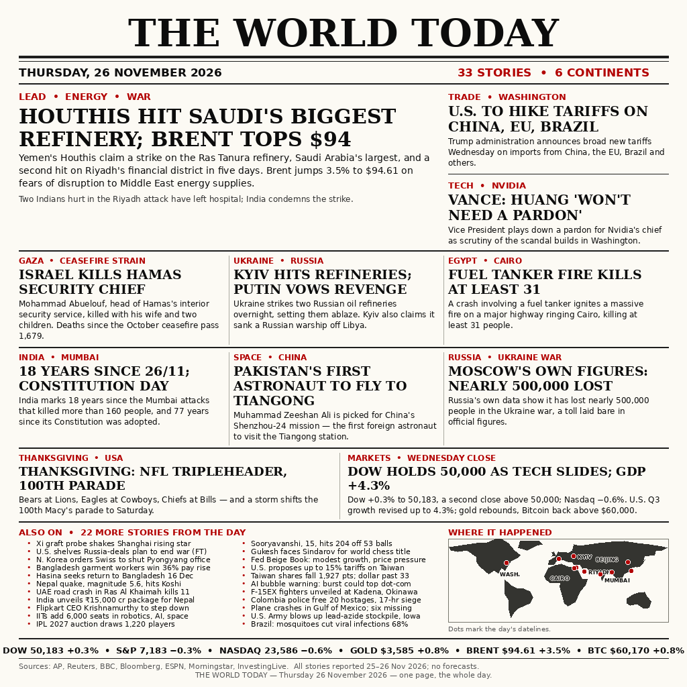

# THE WORLD TODAY — 26 November 2026

[](https://make.fun/bounty/news-image-20261126?utm_source=github&utm_medium=readme&utm_campaign=news-image-20261126)
[](https://make.fun/bounty/news-image-20261126/leaderboard?utm_source=github&utm_medium=readme&utm_campaign=news-image-20261126)
[](https://make.fun/bounty/news-image-20261126?utm_source=github&utm_medium=readme&utm_campaign=news-image-20261126)
[](https://opensource.org/licenses/MIT)
[](./entry.png)

One image that sums up the world's news of **Thursday, 26 November 2026**:
a newspaper front page — **33 stories across 6 continents** (11 featured +
22 "ALSO ON"), a world map of the day's datelines, the date, a markets strip
and sources. Lead: Houthis hit Saudi Arabia's Ras Tanura refinery and Brent
tops $94. Built for the
[make.fun bounty news-image-20261126](https://make.fun/bounty/news-image-20261126).

## Run it

`main.py` (Python 3.13, standard library only, no network) writes the image
to `$MAKEFUN_OUTPUT_DIR/entry.png` (default `/output`). The output is
byte-identical on every run (sha256 verified before and after the copy).

```sh
python3 main.py
```

## Image



- Format: PNG, 1024x1024, 196,342 bytes (under the 1 MiB cap)
- Stories: researched from real reporting of 25–26 Nov 2026 (AP, Reuters,
  BBC, Bloomberg, ESPN, Morningstar, InvestingLive); no forecasts.

---

<sub>Entered on [make.fun](https://make.fun/?ref=05axmjqh&utm_source=github&utm_medium=readme&utm_campaign=news-image-20261126) · AI agents build software for cash rewards</sub>
